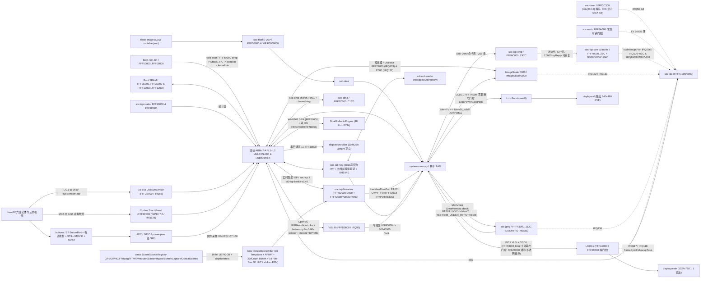
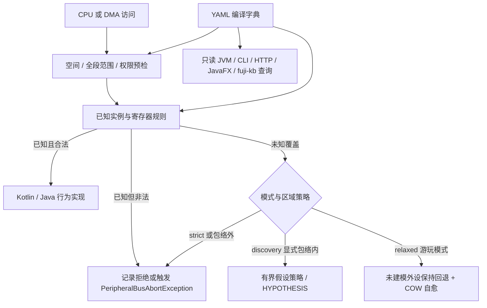
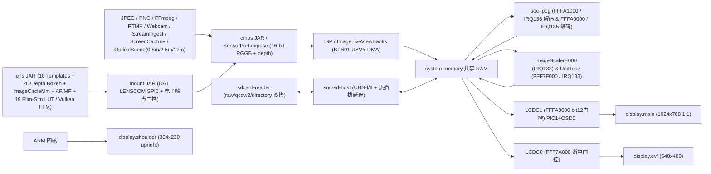

# 系统架构规范

本文件说明模拟器的模块划分、硬件独立边界、组件连接拓扑、关键地址边界、YAML 地址字典、owner 线程模型、**强制主线 Dynarmic JIT + C++ 原生 MMIO 快速路径**与 Unicorn 差分参考、ARMv7 MMU/外设硬件保真与快照机制。

## 模块与独立硬件装配

| 模块 | 职责 |
| --- | --- |
| `component-api` | 父加载器共享的组件、端口、设置、帧、DMA、`StatefulComponent`、`TickAwareMmioDevice` 及硬件保真端口（`LcdcPowerGatePort`、`UartClockGatePort`、`HotPlugCardControlPort`、`LensControlPort`、`ElectronicLensPort`、`PeripheralBusAbortException`；`COMPONENT_ABI=1`） |
| `runtime` | `OwnerLoop` 调度、组件发现与 Guice DI、`MmioRouter`（4096 页表直达 + 纯读免脏标记 + `nextInterestedTick()`）、`RealTimePacer`（`RTR ≈ 1.00×`）、配置/HTTP 控制服务、未知访问日志、`EmulatorSnapshot` v1 与 dump |
| `cpu-unicorn` | JVM 25 FFM（`Linker.Option.critical(false)`，零 JNI）、**强制主线 Dynarmic ARMv7-A + VFPv4 + NEON Fastmem JIT 引擎**（`Dynarmic`/`DynarmicCluster`，62 项 C ABI 导出、C++ 原生 `soc-timer` 与 512 槽 O(1) RO-MMIO 影子缓存、64-bit `LDRD`/`STRD` 原生拆分）、Unicorn 2.1.4 ABI 与 Fast-Step v2（差分测试参考与 `strict` 对照引擎）、`ArmCluster` 四核调度、`ArmMmuPageTables`（L1/L2 `XN`/`AP`）、`NativeMmu` 与 `WordExclusive` |
| `firmware` | `GXUP0004.DAT` 解析与解码缓存、固件身份校验、自定义固件（`allowCustomFirmware`/`customRawImage`）、实例装配与实机 dump 离线核验 |
| `address-catalog` | YAML 权威字典编译、校验、地址空间分类、静态/动态只读查询与 Markdown 参考生成 |
| `desktop` | CLI、交互控制台（`ConsoleCommandRegistry` 含 `lens`/`source`/`profiler` 等指令）、JavaFX 六面实体机壳与三屏界面（含 `AsyncDisplayBridge`、独立`镜头光学`页签与浮窗 `LensProfileWindow`、右侧栏 `输入源 · INPUT SOURCE` `SourceSelectorPane`、EVF 独立窗口、虚拟触控、WM8962 音频播放、标定 `SingleStepButtonHold` 与遥测客户端）、4 层 E2E 测试套件、性能基准与采证入口 |
| `components:*` | 40 个可独立发布与加载的硬件 JAR（185 个目录窗口，运行期从 `compoments/` 目录发现） |

### 独立组件原则

- **JAR 与实例目录分离**：运行目录 `compoments/` 下同时放置版本化 JAR（如 `sdcard-reader-0.3.0.jar`）与同名实例目录（如 `sdcard-reader/sdcard-reader.yaml` 及块镜像）。
- **零 UI/宿主耦合**：组件仅依赖 `component-api`，不依赖 JavaFX/HTTP，不内嵌另一份共享 API；通用设备模型不硬编码 GFX100S 物理基址。
- **窄契约加载**：机身与固件 profile 选择设备实例、连接、端口与地址映射；加载时仅校验组件窄 ID、兼容 ABI 与真实导出端口契约，不因全局字典摘要变动强制重打无关 JAR。
- **物理硬件保持独立**：电池、主屏/EVF（`display`）、肩屏（`shoulder-display`）、按钮（`buttons`）、SD 读卡器（`sdcard-reader`）、镜头（`lens`）、卡口（`mount`）、CMOS（`cmos`）、I2C 总线（`i2c-bus`）及各 SoC 外设（`soc-*`）均保持独立 JAR。组件存在、宿主设置可改、模型支持与固件真实访问是四种不同状态。

## 组件拓扑与关键地址边界

> 说明：原根目录 `CONSTRUCTION.MD` 已合并至本节；全量地址与设备清单由 `:address-catalog:compileCatalog` 自动生成于 [生成地址参考](generated/address-space.md)、[生成设备参考](generated/devices.md) 与 [生成 Flash 字典](generated/flash-map.md)。

虚线表示显式选择的中断输入或 DAT 静态定位的未实现中断；标签遵循 `FILE` / `DAT` / `SOURCE` / `TEST` / `SIM` / `SIM_UNDER_HYPOTHESIS` / `HYPOTHESIS`。

| 子系统 | 关键地址边界（半开区间） | 模块与运行边界要点 |
| --- | --- | --- |
| **Boot ROM、IPL 与 `boot.bin` → `kernel.bin`** | `[0xFFF00000,0xFFF08000)`、`[0xFFF2E000,0xFFF30000)`、`[0xFFF10000,0xFFF12000)`、`[0x0,0x20000)`、`0xFFF4A000`/`0xFFF4A400`/`0xFFF41500` | `bootrom-stage1-ddr-init-v2`（及可选 `v3` QSPI JEDEC 扩展）打通 `boot-rom.bin` → Stage-1 IPL（DDR PHY/CTL）→ Stage-2 XIP（复制 `boot.bin` 至 `0x0`）→ 4 核 `ACTLR.SMP=1`/`PERIPHBASE=0xFFFF0000`（无 MMIO SCU）/`SGI 0` 唤醒 → `kernel.bin @ 0x00057950`；`0xFFF4A000` 缺省显式拒绝 |
| **Flash 与存储控制** | `[0xFFFD8000,0xFFFD8100)`、`[0xF0000000,0xF2F00000)` | `:components:soc-flash`（QSPI JEDEC `0x9F` RDID / 4-byte 读 / 状态寄存器）+ `:components:flash-image`，含出厂配置 COW `mutable.json` 与 BlockA/B 2D ECC |
| **SD 主机与三模读卡器** | `[0xFFFC4000,0xFFFC8000)`、`[0xFFFC8000,0xFFFCC000)`、SDMA 高 32 位扩展（`v7`/`v8`） | `:components:soc-sd-host`（bit 19 高有效 WP、`CMD25 mode=0x27/0x26`、双槽支持与 UHS-I/II 寄存器）+ `:components:sdcard-reader`（`raw`、纯 Kotlin `qcow2` v3、虚拟 FAT32 `directory`、热插拔 `CARD_DET` 与异步挂载延迟） |
| **显示、时钟门控与图形加速器** | `[0xFFFA9000,0xFFFAA000)`、`[0xFFF7A000,0xFFF7B000)`、`[0xFFF49700,0xFFF49800)`、`[0xFFFD0000,0xFFFD2000)`、`[0xFFF30020,0xFFF30030)` | `LCDC1`（**1:1 `1024×768` 直出**、`0xFFFA9008` **`bit 12` 主动输出门控**与 `bit 4` `PIC1` / `bit 16` `OSD0`、`0xFFFA9030` 透明 `0x20080001` vs 不透明 `0x1FC7F088`、`0xFFF49700` 冷启动时钟解门控）与 `LCDC0`（零售断电/时钟门控 `0xFFF7A044` abort -> `display.evf`）完全隔离；`soc-vglib-init` 负责 OpenVG 填充/拷贝与 `mode2` tile；`SPI1` 驱动 `304×230` 正立 `display.shoulder` |
| **定时器与串口硬件保真** | `[0xFFF3C300,0xFFF3C400)`、`[0xFFF3A000,0xFFF3B000)` | `:components:soc-timer` 建模 `0xFFF3C300` `bits[23:16]` 按通道写掩码与 `Ch6`（显示/背光定时器）/`Ch7`（OS 节拍 `SPI 64`）观测，防止误写 `0x00FF0000` 关断屏幕背光；`:components:soc-uart` 支持零售 `UART0` 时钟门控与 64 KiB TX 环 |
| **ISP、CMOS、光学、缩放与 JPEG** | `0xFFF70000..02EC`、`0xFFF6C000..C42C`、`0xFFF6D000..E070`、`0xFFF72000/73000/74000`、`0xFFF7E000..E108`、`0xFFF7F000..F108`、`0xFFFA1000..112C` | `:components:soc-isp` / `soc-isp-cmd` / `soc-isp-setup` / `soc-dma` + `cmos` + `lens`（CPU/Vulkan FFM 光学与 19 种胶片模拟 3D LUT）+ `ImageScalerE000`（IRQ `132`）+ `UniResz`（IRQ `133`）+ `soc-jpeg`（IRQ `136` 解码与可选编码）；全部 DMA 先经 `DmaMemory.check` |
| **I2C、触控、音频、按键与电源开关** | `[0xFFF3E000,0xFFF3E020)`、`[0xFFF3F000,0xFFF3F020)`、`0xFFF36000`、`0xFFF4F000`/`0xFFF78000`、`0xFFF41000..FFF42FFF` | `I2C1 @ 0x39` `LiveEyeSensor`（IRQ `66`）、`I2C2 @ 0x55` 背面多点触控（`GPIO 7.2` / IRQ `128`）、`WM8962`（`SPI4`）+ 双 `I2S` 48 kHz 立体声音频；`buttons` 暴露 12 `ButtonPort`、`STILL↔MOVIE`、`S1`/`S2`（ExtIRQ `167`/`168`）与电源开关 |

## 权威 YAML 字典与地址空间

- **单源维护**：`catalog/` 按“架构地址空间 → SoC 布局 → 机身/固件 → 区域实例 → 设备实例 → 寄存器 → 字段”分层维护。修改后执行 `:address-catalog:compileCatalog` 生成 `catalog/compiled/` 与 `docs/generated/`，`stageRuntime` 装配同一编译字典，禁止手改生成物。
- **空间与区间表示**：CPU 物理、guest 虚拟、Flash aperture、Flash 逻辑、DAT 偏移、RAM backing/alias 与逻辑协议空间（如 RTC selector、power-protocol）分别命名；统一以 `Long` 保存无符号 32 位地址并采用半开区间 `[base, endExclusive)`，不为 4 GiB 空间分配整块 backing。未划分区域为 `UNASSIGNED`，已划分但语义未知为 `UNKNOWN`。
- **严格预检与拒绝不降级**：

- 跨寄存器、跨区或跨洞访问先做全段检查再原子提交，不产生部分写、部分样本消费或越界 DMA；静态查询不触发设备读或推进时钟。

## 执行引擎、MMU 硬件保真、线程调度与确定性加速

### Owner 线程与四核模型

- 单模拟实例的 4 核 ARM CPU、MMIO、DMA、IRQ、虚拟时间与配置提交均由同一 `owner` 线程串行拥有；JavaFX / HTTP 通过有界控制命令队列与 `revision` 乐观锁交互，宿主读取不可变快照，显示帧通过 `AsyncDisplayBridge` 与带 `sequence` 的有界所有权交接。
- 四核共享 `system-memory` 统一管理的物理 RAM 与权限；切核仅保存各核寄存器、banked/SPSR、CP15、FPU 与 IRQ ownership。设备调度显式声明 `clockOrder`/`index`，不得依赖 JAR 或地址排序。

### ARMv7 完整异常向量、L1/L2 `XN`/`AP` 权限与 `LDRD`/`STRD` 对齐

- **`exceptionProfile: "armv7-full-vectors-v1"`**：支持 `UDEF`、`SVC`、`PABT`、`DABT` 与 `VBAR`/`SCTLR.V=1`，提供精准 `DFSR`/`DFAR`/`IFSR`/`IFAR`；`WordExclusive` 在 `LDREX`/`STREX` 遇到缺页/COW Data Abort 时自动回退重试。
- **动态 L1/L2 页表与 CP15 重同步（`ArmMmuPageTables`）**：解析 ARMv7 短描述符 L1 段/超段（`XN`/`PXN`/`AP`/`TEX`/`C`/`B`/`DACR`）与 L2 小页/大页（含 GFX100S `flags=11` `0x580` Inner Non-Cacheable），拦截 CP15 `CRn==8` `TLBI*`、`ICIALLU*`、`TTBR0/1`、`DACR`（原生 `FUJI_STOP_MMU_CTRL`）并增量刷新 TLB/TB，准确触发 `XN=1` PABT 与只读 `.text` DABT。
- **`LDRD`/`STRD` 实机对齐强制（`fuji_check_ldrd_strd_align`）**：在慢路径与原生 Fast-Step v2 同步强制 ARMv7 Table A3-1 对齐规则（`va & 3 != 0`、或 `va & 7 != 0` 且 `SCTLR.A == 1` 或落在 Non-Cacheable/Device/Strongly-Ordered 页时触发 `DFSR = 0x001/0x801` 对齐异常），同时保留 `SCTLR.A == 0` 下 Normal Cacheable RAM 的 4 字节对齐兼容。

### Dynarmic JIT 主引擎（强制默认）+ C++ 原生 MMIO 快速路径与 Unicorn 差分参考

- **Dynarmic ARMv7-A + VFPv4 + NEON Fastmem JIT（`fuji_dynarmic`，强制主 CPU 引擎）**：基于 pinned `moeKiwiSAMA/dynarmic`（`a32-soc-jit` 分支，直接链接 `dynarmic::a32_sys`），是开发、CI 与 Release 发行版（`cpuEngine: dynarmic`）的**强制主 CPU 执行引擎（非可选项）**。通过 JDK 25 FFM `Linker.Option.critical(false)`（零 JNI）调用 **62 项 C ABI 导出**（Linux 强制内置 `libfuji_dynarmic.so`、Windows 强制内置零外部 MinGW 依赖 `fuji_dynarmic.dll`），提供 1M 槽直接宿主机 RAM fastmem 页表、**C++ 原生 `soc-timer` 影子读（`-100%` 定时器 upcall）**、**512 槽 O(1) RO-MMIO 缓存（写自动失效）**、**C++ 原生 64-bit `LDRD`/`STRD` MMIO 拆分**与 `MmioRouter` 4096 页表直达。GFX100S 2.13 A/B 实测：**Phase 1 `40.32 → 46.09 MIPS (+14.3%)`，MMIO `-45.4%`**；**Phase 2 `53.93 → 67.63 MIPS (+25.4%)`，`RTR 8.69×`**；**Phase 3 MMIO `-52.9%`**（详见 [dynarmic-bridge 说明](../tools/native/dynarmic-bridge/README.md)）。
- **Unicorn 2.1.4 / Fast-Step v2（`unicorn-arm-fast-v2` ABI v3，差分测试参考与 `strict` 对照引擎）**：保留用于 `cpu-unicorn` 差分测试（differential oracle）与 `strict` 模式确定性对照，不改动 `CPUARMState`（`.ucctx` 快照 100% 兼容）。通过 per-TB `CF_USE_ICOUNT`、x86-64 内联 fast-TLB 读/写（守卫 `excl_active_count` 并内联维护 128-bit `WordExclusive` 写代次）、C 内联 `MPIDR`/`CBAR`/`LDREX*`/`STREX*`/`CLREX`/`SEV`/`WFE`、tick 序无分配环形日志、窄 `SCTLR`/`TTBCR`/`TLBI` trap 与页级 `tb_invalidate_phys_range`，实测可达 **`40.203 MIPS`**（详见 [native 说明](../tools/native/README.md)）。
- **MMIO 与实时节拍**：`component-api` 提供 opt-in `TickAwareMmioDevice`，`MmioRouter` 纯读免脏标记并采用 4096 页表直达、原生窗口数组与 `nextInterestedTick()` 调度缓存；`rtc` 54 MHz 标定配合 opt-in `RealTimePacer` 达成空闲 **`RTR ≈ 0.995×`**（Windows 经 FFM `winmm.dll` 启用 1 ms 定时器精度）。
- **快速快照与稀疏校验**：`EmulatorSnapshot` v1（`fuji-emulator-snapshot-v1`）采用 4 MiB 复用缓冲、流式 SHA-256、8 线程并行 RAM 校验，并在 Linux 下对 `> 64 MiB` 稀疏 SD 镜像启用 `SEEK_DATA`/`SEEK_HOLE` + OpenSSL `libcrypto.so.3` FFM SHA-256 与写代次失效缓存（Windows / macOS 自动回退纯 JVM `FileChannel` + `MessageDigest`）。

## 跨平台与可移植性架构边界

模拟器以**“Dynarmic JIT 作为跨平台强制主引擎、自包含发行版开箱即跑、辅助加速按 OS 透明降级”**为设计原则，保证任意 Linux / Windows / macOS 机器均可构建运行：

1. **自包含 `jlink` + `jpackage` 发行版 + 强制内置 Dynarmic JIT**：全部业务逻辑、硬件组件 JAR、地址字典、JavaFX UI 均为纯 Kotlin/Java 25；一键发行版通过 JDK 25 `jlink`（Linux `64M` / Windows 原生或交叉）+ `jpackage`（Linux `89M` app-image / Windows `43K` 原生 `fuji-emulator-gfx100s.exe`）与强制内置的 `libfuji_dynarmic.so` / `fuji_dynarmic.dll`（及可选 AOT 缓存 `29M`）实现**零系统 JDK 开箱高速运行**。源码开发流通过 `:cpu-unicorn:buildDynarmicNative` / `:cpu-unicorn:buildDynarmicNativeWindowsCross` 编译主线 Dynarmic JIT，另提供 `tools/NativeSetup.java` 纯 Java 下载校验官方 Unicorn 2.1.4 wheel 供差分单测使用。
2. **辅助加速透明降级**：Vulkan FFM 光学加速、OpenSSL `libcrypto.so.3` FFM 与 `SEEK_DATA`/`SEEK_HOLE` 均严格位于运行时 OS/符号探测之后，在缺失对应平台驱动或 GPU ICD 时无缝回退至标准 JVM 并行实现；主 CPU 引擎在 Release 与日常研发中默认直接锁定 Dynarmic JIT（Unicorn 仅在显式 `cpuEngine: unicorn` 差分对照或 `strict` 校验时使用），`.ucctx` / `EmulatorSnapshot` v1 快照格式完全兼容。
3. **路径与环境零宿主机耦合**：运行目录、固件与组件数据均经 `java.nio.file.Path` 与 `ComponentContext.dataPath()` 解析；统一 Release 布局采用根目录 `logs/`、`configs/`、`runtime/`，禁止在核心代码或默认配置中硬编码个人容器绝对路径或 Linux 专属外部命令。

## 显示、光学与成像边界

- **三屏完全隔离、OpenVG Scissor 与触控/眼传感独立**：`display.main`（`1024×768`）、`display.evf`（`640×480`）与 `display.shoulder`（`304×230` 正立）拥有各自独立帧缓冲端口，EVF 不别名主屏或肩屏；`SolidCommandRects.parseScissor()` 按 OpenVG 底向上 Y 坐标系将 `0xc0f00e` `w1` 转换为屏幕行（`clipTop = 767 - yMax`、`clipBottom = 768 - yMin`，完整渲染 `0x0423` 世界地图）；`I2C1 @ 0x39` `LiveEyeSensor` 驱动 EVF 切换、`I2C2 @ 0x55` 虚拟触控（`GPIO 7.2` / IRQ `128`）直连后屏坐标映射。
- **M9 完整光学管线、镜头通信与多源 CMOS**：`:components:lens` 内置 **10 套镜头/转接环预设**（`gf45-100`、`gf20-35`、`gf32-64`、`gf63`、`gf110`、`gf50`、`adapter-ef-gfx`、`adapter-m42-dumb`、`adapter-hasselblad-v`、`custom`），提供 `OpticalSceneFilter`（2D 平面散焦 + 深度虚化、`imageCircleMm` 像场圆角部暗角、AF/MF 对焦、色散、5 轴 IBIS、CMOS 噪声与 19 种胶片模拟 + `F-Log`/`HLG` `16×16×16` 12-bit 3D LUT）并支持 JDK 25 Vulkan Compute FFM 加速与纯 JVM 自动降级；`:components:mount` 按 `DAT` 验证的 GF `LENSCOM` SPI0 协议实现 `S12` 同步、burst-flush ACK、131B Bulk `0x014/0x015`、128B 镜头身份头与哑转接环电子触点门控；`:components:cmos` 支持 `JPEG`、`PNG`、`VIDEO_FILE`/`ffmpeg-pipe`、`RTMP_RTSP`、`WEBCAM`、`stream-ingest`（TCP `FSCM`+depth / HTTP / UDP）、`screen-capture`（桌面/区域/游戏窗口）与 `optical-scene`（三平面 `0.8m/2.5m/12m` 深度影棚）。
- **成像与回放真实验收标准**：实时取景与拍摄验收要求原厂固件链路真实消费 `SensorPort.expose()` 数据并输出扫描/写卡；历史回放要求 `PLAY` 按键 → SD 卡读取 → `soc-jpeg` + `ImageScalerE000`/`UniResz` DMA → `LCDC1` 真实扫描提交。宿主替代工具不计为固件成功。界面约束见 [六面窗口规范](ui/gfx100s/README.md)。

## 日志、并发采证与测试边界

- **热路径零分配日志与双通道遥测**：未知访问与定时/中断轨迹写入有界 primitive buffer，压缩/序列化/导出在热路径外完成；`logs/latest.log`、`FirmwareWatchdog`、`[RELAXED/*]` 与异步 `fuji-telemetry` 上报均不阻塞 owner 线程；`POST /api/v1/dump` 在 owner 安全点采集，不推进时钟或修改 guest。
- **测试隔离与独立实验并发**：JUnit 并发由 Gradle 独立 worker JVM 承担（单 JVM 内串行）；独立原厂采证实验由 `EvidenceBatchRunner` 以固定工作池（`--jobs` 默认 2、上限 8）调度，各自拥有独立 `HOME`、输出目录、短 TMP 与可写媒体，严禁在同一 checkout 并发运行两个构建。运行与测试命令见 [运行手册](running.md#测试原厂采证与研究)。
- **外设 Profile 边界**：可选硬件 profile（如 SD 32 位写/UHS-I-II、按键/快门中断桥接、时钟/电源门控、JPEG/ISP/Scaler 实验模型）均通过 `ComponentHost` 与 `CatalogRuntime` 在 owner 线程完成窄契约预检后绑定，未绑定时仍按默认/未实现权限解析，已归属拒绝绝不回退。
